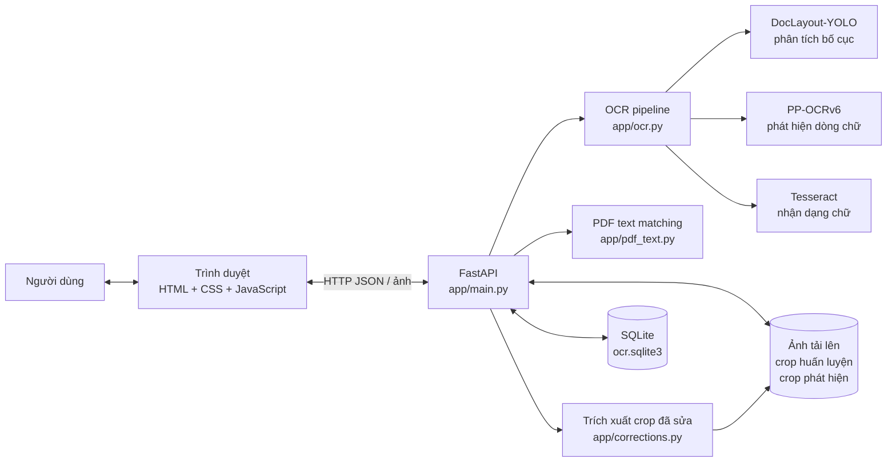
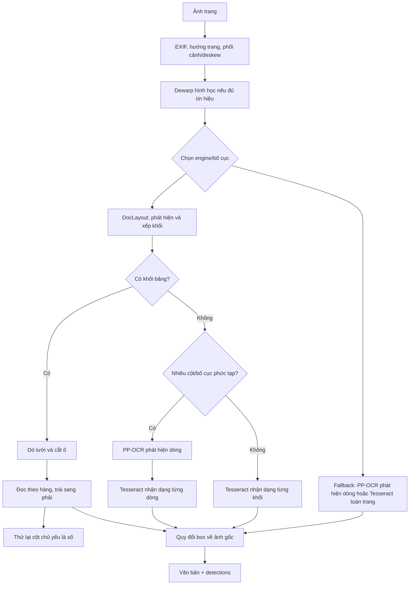

# Kiến trúc hệ thống OCR tiếng Việt

## 1. Mục tiêu và phạm vi

Đây là ứng dụng web chạy local để nhận dạng chữ tiếng Việt trên ảnh/PDF, cho phép người dùng đối chiếu ảnh gốc với vùng OCR, sửa kết quả và lưu các crop đã sửa làm dữ liệu tham khảo cho việc huấn luyện sau này.

Kiến trúc hiện tại là một ứng dụng đơn khối (modular monolith): một tiến trình FastAPI/Uvicorn phục vụ API và giao diện, đồng thời gọi các thư viện OCR chạy trong cùng máy. SQLite và thư mục ảnh là nơi lưu dữ liệu. Không có dịch vụ huấn luyện model tự động hoặc hàng đợi xử lý riêng.

## 2. Sơ đồ thành phần



DocLayout và PP-OCR đảm nhiệm phát hiện/phân chia vùng; Tesseract là bộ nhận dạng ký tự chính. PP-OCR không đọc nội dung chữ trong kiến trúc hiện tại.

## 3. Cấu trúc mã nguồn

| Thành phần | Trách nhiệm |
|---|---|
| `app/main.py` | Khởi tạo FastAPI, phục vụ trang web, định nghĩa API, kiểm tra tệp tải lên, điều phối OCR/PDF và cập nhật dữ liệu. |
| `app/ocr.py` | Tiền xử lý ảnh, định hướng/deskew/dewarp, phát hiện bố cục và dòng, chọn nhánh OCR, nhận dạng bằng Tesseract, sắp xếp kết quả và quy đổi tọa độ box về ảnh gốc. |
| `app/pdf_text.py` | Ghép các đoạn văn bản có sẵn trong PDF với các dòng OCR phù hợp mà không làm thay đổi thứ tự OCR không liên quan. |
| `app/corrections.py` | So sánh văn bản OCR ban đầu với bản người dùng sửa, xác định dòng bị sửa và cắt ảnh tương ứng thành mẫu có nhãn. |
| `app/database.py` | Khởi tạo SQLite, truy vấn/cập nhật tài liệu, quản lý mẫu huấn luyện/phát hiện và xử lý loại bỏ mẫu trùng. |
| `app/static/index.html` | Giao diện HTML/CSS/JavaScript: tải ảnh/PDF, xem ảnh và kết quả, điều hướng trang PDF, sửa văn bản, tô sáng box, chọn vùng bỏ sót hoặc điều chỉnh box. |
| `tests/test_ocr_layout.py` | Kiểm thử luồng OCR, sắp xếp bố cục/bảng, ánh xạ tọa độ, PDF và các nhánh phát hiện/nhận dạng liên quan. |
| `requirements.txt` | Bộ phụ thuộc CPU, gồm PaddlePaddle CPU và PaddleOCR. |
| `requirements-gpu.txt` | Bộ phụ thuộc GPU NVIDIA, dùng PaddlePaddle GPU CUDA 11.8 và PaddleOCR. |
| `Chay_OCR_CPU.bat`, `Chay_OCR_GPU.bat`, `Chay_OCR_Launcher.bat` | Khởi chạy server bằng môi trường Conda tương ứng và đặt thư mục dữ liệu mặc định trong LocalAppData. |

## 4. Luồng xử lý

### 4.1 Khởi động

1. Launcher chọn môi trường `ocr-local` hoặc `ocr-gpu`, đặt `OCR_DATA_DIR` thành `%LOCALAPPDATA%\OCR-Vietnamese\data`, rồi chạy `python -m uvicorn app.main:app --host 127.0.0.1 --port 8000`.
2. FastAPI gọi `database.initialize_database()` khi khởi động.
3. Giao diện tĩnh được phục vụ từ `app/static/index.html`; danh sách tài liệu gần đây được tải từ `GET /api/documents`.
4. Nếu chạy Uvicorn thủ công mà không đặt `OCR_DATA_DIR`, dữ liệu mặc định nằm tại `data` trong thư mục project.

### 4.2 Tải ảnh

1. Trình duyệt gửi `POST /api/documents` với ảnh và tên engine.
2. API giới hạn kích thước ảnh ở 15 MB, kiểm tra định dạng được hỗ trợ và lưu ảnh gốc trong `uploads`.
3. API chạy hàm nhận dạng trong thread pool để không chặn event loop trong lúc xử lý ảnh.
4. OCR trả về văn bản đã ghép dòng cùng danh sách detection gồm nội dung, box tọa độ và confidence (nếu có).
5. API lưu văn bản gốc, bản sửa khởi tạo, engine, trạng thái, detections và thời gian vào SQLite; trả tài liệu về giao diện.

### 4.3 Tải PDF

1. API kiểm tra PDF, giới hạn tối đa 25 trang và giới hạn kích thước tổng ảnh render.
2. Từng trang được render thành ảnh và chạy qua pipeline OCR chung.
3. Nếu PDF có lớp text, `app/pdf_text.py` tìm đoạn phù hợp để thay nội dung OCR tương ứng.
4. Mỗi trang được lưu như một tài liệu ảnh riêng trong SQLite, gắn `pdf_id`, tên PDF nguồn và số trang để giao diện điều hướng giữa các trang.

### 4.4 Pipeline OCR



Các bước chuẩn hóa trang có thể gồm đọc EXIF, sửa hướng bằng Tesseract OSD, hiệu chỉnh phối cảnh khi tìm được biên trang, deskew và dewarp hình học khi có đủ tín hiệu. Luồng cụ thể phụ thuộc engine và kết quả phát hiện; các phép biến đổi ảnh được ánh xạ ngược để box trả về bám trên ảnh gốc.

### 4.5 Sửa kết quả và thu thập mẫu

- Khi người dùng lưu bản sửa qua `PUT /api/documents/{document_id}`, ứng dụng so sánh bản sửa với OCR gốc. Những đoạn khác biệt có thể được ghép với detection tương ứng để cắt crop ảnh và lưu nhãn vào kho `training_samples`.
- Crop được fingerprint để gộp ảnh trùng; nếu cùng crop có nhiều nhãn khác nhau, mẫu được đánh dấu xung đột để rà soát.
- Khi người dùng điều chỉnh box của một dòng, `POST /api/documents/{document_id}/detections/adjust` OCR lại vùng mới, cập nhật detection và có thể lưu crop có nhãn vào `detection_samples`.
- Khi chọn vùng chữ bị bỏ sót, `POST /api/documents/{document_id}/regions` OCR vùng đó rồi chèn detection vào tài liệu.
- Việc sửa hiện tại **chỉ thu thập dữ liệu có nhãn**; không tự huấn luyện, cập nhật trọng số hoặc triển khai model mới.

## 5. Các nhánh nhận dạng

| Engine API | Hành vi chính |
|---|---|
| `doclayout_tesseract` | Lựa chọn mặc định trên giao diện. DocLayout phân loại khối; bảng được xử lý theo ô/hàng, cột chủ yếu là số có thể được OCR lại với whitelist số. Bố cục chữ thường chọn Tesseract theo khối hoặc PP-OCR phát hiện dòng rồi Tesseract nhận dạng, tùy độ phức tạp. |
| `doclayout_ppocr_tesseract` | DocLayout sắp xếp khối; PP-OCR phát hiện dòng và Tesseract nhận dạng. Bảng vẫn được chuyển qua xử lý bảng chuyên biệt. |
| `tesseract` | Nhánh tương thích dùng DocLayout để lấy vùng và Tesseract nhận dạng trực tiếp trong vùng; khi không có vùng thì dùng toàn trang. |
| `ppocrv6`, `paddle` | Các tên tương thích/nhánh cũ. PP-OCR dùng cho phát hiện dòng; việc nhận dạng ký tự vẫn do Tesseract thực hiện. |

Các lựa chọn giao diện được giới hạn ở ba cấu hình phục vụ tài liệu dạng văn bản, CV/portfolio và tự chọn theo bố cục.

## 6. API chính

| Method | Endpoint | Mục đích |
|---|---|---|
| `GET` | `/` | Tải giao diện. |
| `GET` | `/api/health` | Kiểm tra sức khỏe server. |
| `GET` | `/api/documents` | Liệt kê lịch sử tài liệu. |
| `POST` | `/api/documents` | Tải ảnh/PDF và chạy OCR. |
| `GET` | `/api/documents/{id}/image` | Lấy ảnh trang gốc. |
| `GET` | `/api/documents/{id}/pages` | Lấy các trang cùng PDF. |
| `POST` | `/api/documents/{id}/regions` | OCR vùng được chọn và chèn nội dung bỏ sót. |
| `POST` | `/api/documents/{id}/detections/adjust` | OCR lại một vùng dòng, cập nhật box và thu thập mẫu phát hiện. |
| `PUT` | `/api/documents/{id}` | Lưu bản sửa và trích xuất mẫu huấn luyện. |
| `GET` | `/api/training-samples` | Liệt kê mẫu OCR đã gán nhãn. |
| `GET` | `/api/training-samples/{id}/image` | Lấy crop của mẫu OCR. |
| `GET` | `/api/detection-samples` | Liệt kê mẫu phát hiện dòng. |
| `GET` | `/api/detection-samples/{id}/image` | Lấy crop mẫu phát hiện. |
| `GET` | `/api/training-data/paddle/detection` | Xuất mẫu phát hiện theo cấu trúc nhãn cho Paddle. |

## 7. Lưu trữ

Thư mục gốc dữ liệu là `OCR_DATA_DIR`; nếu không đặt biến này, ứng dụng dùng `data` trong project.

```text
<OCR_DATA_DIR>/
├── ocr.sqlite3
├── uploads/                 # Ảnh gốc hoặc ảnh từng trang PDF
├── training_samples/        # Crop dòng OCR đã sửa và nhãn
└── detection_samples/       # Crop cùng polygon/nhãn phát hiện
```

Các bảng SQLite chính:

- `documents`: tài liệu/trang, OCR gốc, văn bản đã sửa, engine, trạng thái, detections JSON và metadata PDF.
- `training_samples`: crop chữ, nhãn, engine, fingerprint, khoảng dòng và cờ nhãn xung đột.
- `training_sample_sources`: tài liệu nguồn và nhãn của từng mẫu, dùng để quản lý crop trùng có nhiều nguồn.
- `detection_samples`: crop, fingerprint, polygon, nội dung chữ và engine phát hiện.
- `detection_sample_sources`: liên kết mẫu phát hiện với tài liệu và detection nguồn.

Ảnh và crop được lưu thành tệp; SQLite lưu metadata và đường dẫn tương đối. Dữ liệu trong `data/` không được commit vào Git.

## 8. Triển khai và ranh giới tin cậy

- Cấu hình launcher chỉ bind Uvicorn vào `127.0.0.1`, phù hợp dùng trên máy local.
- Quick Tunnel/Cloudflare không phải thành phần bắt buộc của project; đó là tiến trình bên ngoài dùng để chuyển tiếp truy cập từ Internet đến server local. Khi bật tunnel, các API tải tài liệu và ảnh có thể được truy cập từ bên ngoài. Trạng thái hiện tại không có lớp xác thực người dùng trong ứng dụng, vì vậy không nên chia sẻ tunnel công khai khi chưa bổ sung xác thực và chính sách truy cập.
- Server cần quyền đọc/ghi thư mục dữ liệu. SQLite phù hợp cho một tiến trình ứng dụng local; triển khai nhiều worker hoặc nhiều máy cần xem lại chiến lược khóa, giao dịch và lưu tệp dùng chung.
- Model DocLayout/Paddle và dữ liệu ngôn ngữ Tesseract được cài/tải riêng trong môi trường chạy; lần chạy đầu có thể cần Internet để lấy model.

## 9. Giới hạn và hướng mở rộng

- Hiện tại việc xử lý nhiều tệp trong giao diện là tuần tự; chưa có hàng đợi nền, worker riêng hoặc API theo dõi tiến độ.
- Mẫu đã sửa được lưu để huấn luyện/đánh giá sau; chưa có pipeline kiểm duyệt dataset, train, đánh giá, version hóa model và rollout.
- SQLite cùng thư mục tệp là thiết kế local đơn máy; quy mô nhiều người dùng nên chuyển sang cơ sở dữ liệu và kho file có quản lý đồng thời.
- Nếu cần triển khai truy cập từ xa: bổ sung đăng nhập/phân quyền, giới hạn kích thước/tần suất, nhật ký truy cập, HTTPS và quy trình sao lưu trước khi mở tunnel.

## 10. Kiểm thử

```powershell
python -m unittest discover -s tests -v
```

Các kiểm thử tập trung vào pipeline OCR và bố cục. Khi thay đổi API, schema, xử lý upload hoặc giao diện, nên bổ sung kiểm thử tương ứng ngoài bộ kiểm thử OCR hiện tại.
